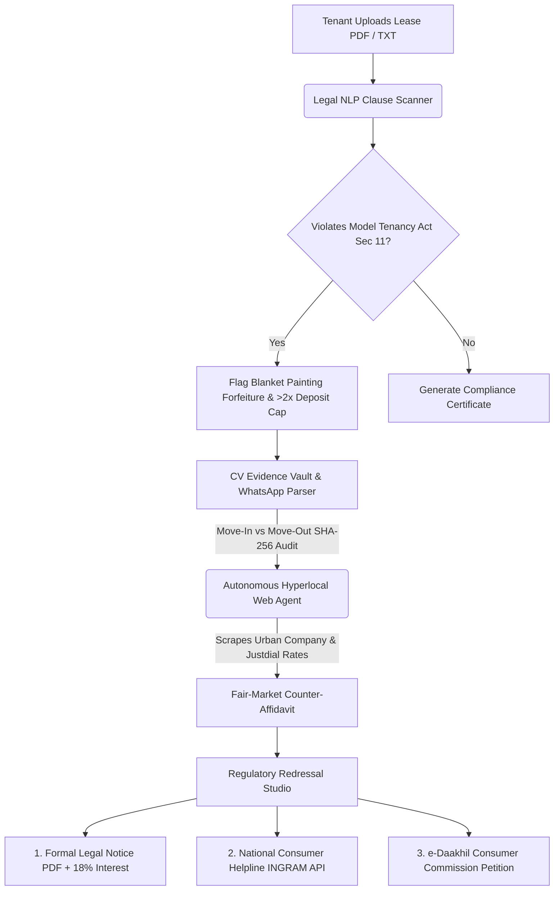

# 🛡️ KiraayaShield Pro (v2.0) — Autonomous Tenant Rights & Deposit Recovery Agent

> **🚀 Built for the "Hack the Unseen" Hackathon**  
> *Transforming India's silent ₹12,000+ Cr security deposit withholding crisis into an automated, evidence-backed, 90-second legal recovery workflow.*

---

## 🎥 Live Video Demo

<video src="public/video.mp4" controls="controls" style="max-width: 100%; border-radius: 12px;">
  Your browser does not support the video tag. Place <code>video.mp4</code> inside the <code>public/</code> folder.
</video>

---

## ⚠️ The "Unseen" Problem
Tenants across India—especially college students, interns, and young professionals relocating to cities like Noida, Bengaluru, Mumbai, and Pune—routinely lose **30% to 50% of their security deposit** when vacating rented flats or PGs. Landlords arbitrarily deduct ₹15,000–₹35,000 under vague pretexts like *"mandatory acid deep cleaning"* and *"full flat repainting"* without providing vendor bills. Because hiring a lawyer costs more than the deducted amount, millions of renters silently accept this exploitation as an unavoidable "moving tax."

---

## 💡 Why KiraayaShield Over Generic ChatGPT?

| Capability | Generic ChatGPT | 🛡️ KiraayaShield Pro (v2.0) |
| :--- | :--- | :--- |
| **Hyperlocal Rate Verification** | Cannot check local vendor pricing | **Autonomous Web Agent** scrapes live Urban Company, NoBroker & local Tier-1 rates to disprove inflated repair claims |
| **Move-Out Photo Proof** | Text-only advice | **Computer Vision Room Auditor** compares Move-In vs Move-Out photos with **SHA-256 Chain-of-Custody** & EXIF timestamps |
| **Statutory Clause Mapping** | Generic summaries | Flags violations of **Section 11 of the Model Tenancy Act 2021** (2-month cap & same-day refund) + **Section 74 Contract Act** |
| **Grievance Redressal Output** | Generic letter draft | Generates **Print-Ready Legal Notice (18% p.a. interest)**, **NCH (INGRAM) JSON Payload**, and **e-Daakhil Consumer Petition** |
| **Preventive Ecosystem** | None | **2-of-3 Multi-Sig Smart Deposit Escrow** + Crowdsourced **Landlord Reputation Registry** |

---

## ⚙️ System Architecture & Autonomous Pipeline



---

## 📂 Repository Structure

```text
KiraayaShield_Pro/
├── index.html                  # Main v2.0 Enterprise Workspace (Google M3 + Microsoft Fluent 2 UI)
├── styles.css                  # Custom Glassmorphism, Laser CV Scanner & Print-PDF Styles
├── app.js                      # Full Interactive Client Engine + Multi-Lingual (6 Indian Languages)
├── server.js                   # Local Node.js + Express Backend Server
├── vercel.json                 # 1-Click Vercel Serverless Deployment Config
├── package.json                # Node Dependencies & Scripts
├── sync.py                     # 1-Click Git Add + Commit + Push Automation Script
├── api/                        # Vercel Serverless Backend Endpoints
│   ├── analyze-lease.js        # POST /api/analyze-lease (Legal NLP Clause Scanner)
│   ├── scrape-rates.js         # GET  /api/scrape-rates  (Hyperlocal Market Rate Benchmark)
│   └── generate-complaint.js   # POST /api/generate-complaint (NCH INGRAM Docket Generator)
├── backend_python/             # Python FastAPI Microservice for AI / CV / Hash Verification
│   └── main.py
├── legacy_v1_show/             # Original v1 Lightweight Showcase Mockup
│   ├── index.html
│   ├── styles.css
│   └── script.js
└── public/
    └── video.mp4               # Place your downloaded demo video here
```

---

## ⚡ Quick Start & Terminal Commands

### Option A: Zero-Setup Instant Run (No Install Needed)
Simply double-click `index.html` or run Python's built-in server:
```bash
python -m http.server 3000
```
Then open **http://localhost:3000** in your browser.

### Option B: Full-Stack Node.js + Express Server
```bash
npm install
npm start
```
Opens the full-stack server with `/api/*` routes at **http://localhost:3000**.

### Option C: Deploy Instantly to Vercel (Frontend + Serverless APIs)
```bash
npx vercel --prod
```
Or push this repository to GitHub and import it on **vercel.com** — `vercel.json` automatically configures both the static frontend and the `/api/*` serverless backend functions.
